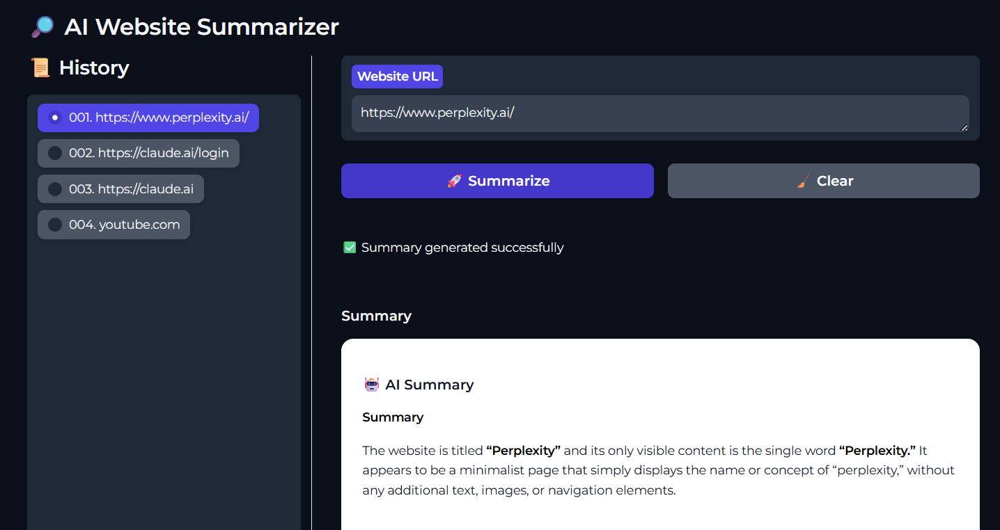

# 🔎 AI Website Summarizer

The internet contains billions of websites, making manual content review and classification practically impossible.

I built a lightweight AI Website Summarizer that converts website content into concise summaries.

The bigger idea is interesting:
* ✅ Content classification
* ✅ Risk detection
* ✅ Website tagging
* ✅ Large-scale web intelligence
* ✅ Automated content monitoring

This project explores the intersection of Backend Engineering, Distributed Systems, and AI-powered content processing.
* 🔗 DNS data: https://ip.thc.org/

A simple AI-powered tool that generates concise summaries from website URLs.



## Why?

Reading long articles, blogs, and documentation can be time-consuming. This tool helps you quickly understand the main points of a webpage using AI-generated summaries.

## Features

- Summarize website content from a URL
- AI-style summary output
- Query history sidebar
- One-click revisit of previous summaries
- Clean and lightweight Gradio UI

## Tech Stack

- Python
- Gradio
- BeautifulSoup / Requests
- AI Summarization Engine


## Project Structure

```text
.
├── src/app.py
├── src/summarizer.py
├── src/requirements.txt
└── README.md
```

## Installation

```bash
git clone https://github.com/<username>/ai-website-summarizer.git

cd ai-website-summarizer

python -m venv venv

# Linux/Mac
source venv/bin/activate

# Windows
venv\Scripts\activate

pip install -r requirements.txt
```

## Run Application

```bash
python app.py
```

Open:

```text
http://localhost:7860
```

## Usage

1. Enter a website URL.
2. Click **🚀 Summarize**.
3. Wait for processing to complete.
4. Review the generated summary.
5. Use the History panel to revisit previous summaries.
